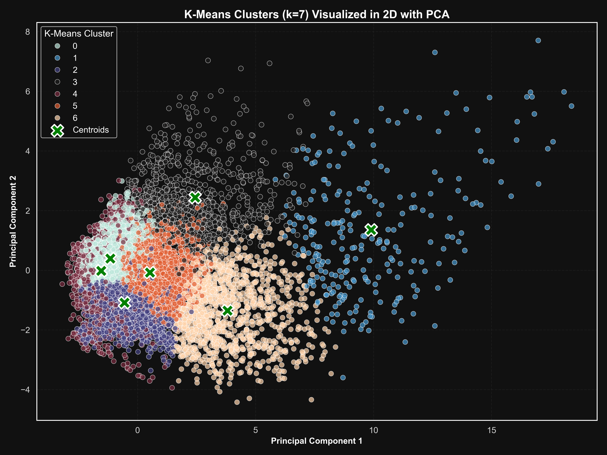
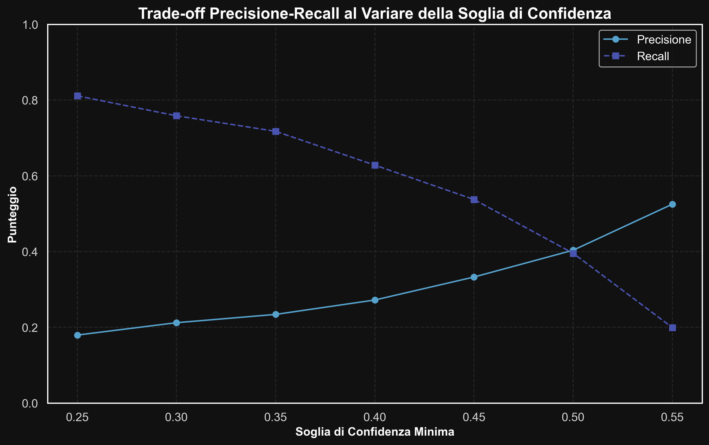
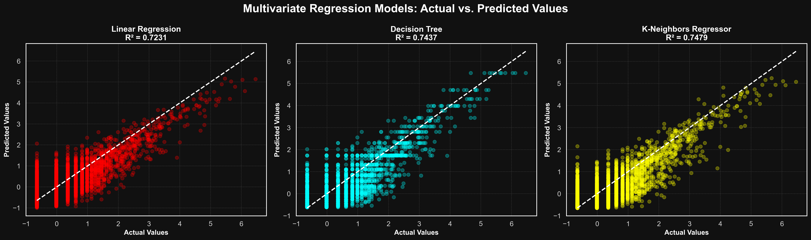

**Author:** Giuseppe Muschetta  
**University:** University of Pisa  
**Degree:** M.Sc. in Data Science & Business Informatics  
**Course:** Data Mining 1  
**Academic year:** 2024–2025  
**Final grade:** 30/30

---

<div align="center">

# Mining the IMDb Universe

### End-to-End Data Mining & Predictive Analytics


**21,909 IMDb titles · 9 analytical notebooks · 5 connected stages of investigation**

[Read the full report](Report/Report.pdf) · [Explore the analysis](#explore-the-notebooks) · [Discover the association rules](#from-frequent-patterns-to-an-interpretable-classifier)

</div>

---

What separates a blockbuster from a festival favorite? Which characteristics are associated with award recognition? How much can movie metadata reveal about audience ratings and engagement?

This project investigates those questions through a complete **Data Mining workflow**, connecting statistical exploration, feature engineering, unsupervised discovery, supervised prediction, and interpretable association rules. Starting from heterogeneous IMDb metadata, it develops a coherent study of the structure, reception, and recognition of movies, television, and other media titles.

Developed by **Giuseppe Muschetta** for the **master's-level examination in Data Mining 1**, as part of the **M.Sc. in Data Science & Business Informatics at the University of Pisa**, the project received **30/30, the maximum grade**. The repository brings together the original notebooks, prepared datasets, analytical figures, and a **26-page technical report** explaining the methodology and findings.



*A map of seven title segments learned from 11 processed numerical features. PCA provides a two-dimensional view of the clustering.*

## Results at a glance

| Area | Highlight | What it reveals |
|:---|:---|:---|
| Audience-engagement regression | **Test R² = 0.7479** | A tuned multivariate KNN regressor predicts log-transformed, standardized user-review volume. |
| Association-rule discovery | **Lift = 4.36; confidence = 57.1%** | A combination of title type, genre, and popularity is strongly associated with award recognition in the mining dataset. |
| Cross-method clustering | **89.78% of K-Means “elite” titles become DBSCAN noise** | Exceptional titles can form interpretable segments while remaining sparse anomalies under a density-based definition. |
| Rating classification | **59.36% test accuracy** | Tuned KNN achieves the highest accuracy among the rating classifiers studied. |
| Custom rule-based prediction | **81.1% award-winner recall in the screening configuration** | Explicit rules support a measurable trade-off between finding more winners and reducing false positives. |

*Results come from the accompanying report and saved notebook outputs. Classification, regression, clustering, and association-rule metrics describe different analytical tasks.*

## The analytical workflow

The study follows five connected stages:

1. **Understand and prepare the data:** examine semantics, distributions, missing values, redundancy, and outliers; construct numerical representations suited to the modeling tasks.
2. **Discover structure:** compare K-Means, DBSCAN, and hierarchical clustering, then interpret the groups through their original metadata.
3. **Predict rating tiers:** compare Decision Tree, KNN, and Naive Bayes classifiers through tuning, confusion matrices, per-class metrics, and ROC analysis.
4. **Mine patterns and build explicit rules:** extract frequent itemsets with FP-Growth and implement a custom classifier for award recognition.
5. **Model audience engagement:** compare linear, tree-based, and neighborhood-based regression with one predictor and six predictors.

## Data understanding and feature engineering

The supplied IMDb dataset contains **21,909 titles and 23 original attributes**, split into **16,431 training rows** and **5,478 test rows**. It combines release dates, runtime, vote counts, reviews, awards, production credits, title types, genres, and countries of origin.

The preparation notebook addresses the practical details that shape every later result:

- **Missing data:** converts non-numerical runtime placeholders into missing values, imputes runtime using the training median, and estimates missing award counts with `IterativeImputer`.
- **Categorical structure:** preserves rating order with ordinal encoding, encodes title types with one-hot features, and creates indicators for the ten most frequent genres and countries in the training data.
- **Redundant information:** uses Pearson and Spearman correlations alongside Cramér's V to guide the removal of constant or redundant attributes.
- **Skewed distributions:** applies `log1p` and standardization to numerical features, retaining their original versions for interpretation.
- **Training-set outliers:** uses Local Outlier Factor with 20 neighbors and 5% contamination, supported by a PCA visualization. Removing 822 flagged rows leaves **15,609 prepared training titles**.

Imputation, encoding, and scaling are fitted on the training data and applied to the test data. The resulting representation supports **11 processed numerical features for clustering** and **41 predictors for rating classification**.

## Discovering the structure of the IMDb universe

Three clustering approaches examine the same numerical feature space from complementary perspectives.

| Method | Selection strategy | Final interpretation |
|:---|:---|:---|
| **K-Means** | Inertia and silhouette analysis over k = 2–50, combined with domain interpretation | **Seven segments**, separating mainstream successes, award-oriented titles, vintage cinema, shorts, television, and low-visibility content. |
| **DBSCAN** | k-distance analysis and targeted exploration of density parameters | **Three clusters plus noise**, using ε = 1.5 and `min_samples = 12`; 1,884 titles are labeled noise. |
| **Hierarchical clustering** | Comparison of single, complete, average, and Ward linkage through dendrograms | A **five-group Ward segmentation**, distinguishing acclaimed titles, popular productions, vintage cinema, television, and low-engagement content. |

Cluster profiles connect numerical summaries with genres, title types, countries, and representative titles. This gives each group an interpretable identity beyond its cluster label.

**A particularly revealing comparison:** 89.78% of the 988 titles in the two small K-Means groups described as the “Hollywood Elite” and “Festival Darlings” are labeled noise by DBSCAN. Their distinctive characteristics make them meaningful groups for a centroid-based method, while their relative rarity makes them anomalies for a density-based method. The analysis shows how algorithmic assumptions influence the story extracted from the same data.

## Predicting audience rating tiers

The classification task groups the original IMDb rating intervals into three categories:

| Class | Original rating range |
|:---|:---|
| **Poor** | At most 6.0 |
| **Average** | Above 6.0 and at most 7.0 |
| **Good** | Above 7.0 |

The notebooks compare baseline and tuned models, using cross-validation for hyperparameter searches and reporting performance on the supplied 5,478-title test split.

| Model | Baseline accuracy | Tuned accuracy | Tuned macro F1 |
|:---|---:|---:|---:|
| Decision Tree | 50.15% | **55.66%** | 0.51 |
| K-Nearest Neighbors | 55.04% | **59.36%** | **0.54** |
| Gaussian Naive Bayes | — | **54.31%** | 0.45 |

The best KNN configuration uses **49 neighbors, Manhattan distance, and distance weighting**. The Decision Tree adds an interpretable view of influential predictors, including title type, release year, genre, and popularity. An additional Bernoulli Naive Bayes experiment explores how a different distributional assumption affects the same feature set.

Across the three principal classifiers, the **Average** tier remains the hardest class to identify. Confusion matrices, per-class precision and recall, and ROC curves make that behavior visible and support a more informative comparison than overall accuracy alone.

## From frequent patterns to an interpretable classifier

Pattern mining converts title metadata into **61 Boolean transaction items**, including discretized numerical attributes and a binary target, `hasWon`, indicating at least one award win.

The notebook explores how minimum support affects the number of frequent patterns, then uses **FP-Growth with 3% minimum support**. It filters patterns containing uninformative constant items and focuses association rules on award recognition, obtaining **75 rules whose consequent is an award win**.

### An explicit pattern of recognition

One of the strongest discovered rules is:

```text
Movie + Drama + very high vote count  =>  At least one award win
```

The rule has **57.1% confidence**, **4.36 lift**, and **3.11% support**. Among titles matching this combination, 57.1% have an award win, compared with approximately 13.1% in the training data used for mining. It identifies a strong, readable association between popularity, content type, genre, and recognition.

### Turning rules into predictions

The project then implements a **custom rule-based classifier**: a title is predicted to have an award win when it matches a qualifying rule; otherwise, it receives the majority-class prediction. A second version introduces a minimum rule-confidence threshold to control how selectively the rules fire.

| Configuration | Award-winner precision | Award-winner recall | Award-winner F1 |
|:---|---:|---:|---:|
| Broad screening: minimum confidence 25% | 17.95% | **81.11%** | 0.29 |
| More selective: minimum confidence 50% | **40.36%** | 39.53% | **0.40** |

The screening configuration identifies **554 of the 683 award-winning titles** in the test split. Raising the threshold more than doubles precision and improves positive-class F1, while reducing recall. The result is an interpretable mechanism for choosing between broad candidate discovery and more selective prediction.



*The original trade-off curve shows how a single threshold changes the classifier's behavior. With a minority award-winning class, precision and recall are central to the evaluation.*

## Predicting audience engagement

The regression task predicts **`userReviewsTotal_proc`**, the log-transformed and standardized number of user reviews. It compares Linear Regression, Decision Tree, and KNN under two feature configurations:

- **Univariate:** processed vote count.
- **Multivariate:** processed vote count, critic-review count, number of regions, award nominations, total credits, and award wins.

| Regressor | Univariate test R² | Multivariate test R² | Multivariate MAE | Multivariate RMSE |
|:---|---:|---:|---:|---:|
| Linear Regression | 0.6402 | 0.7231 | 0.3883 | 0.5247 |
| Decision Tree | **0.6893** | 0.7437 | 0.3636 | 0.5049 |
| K-Nearest Neighbors | 0.6846 | **0.7479** | **0.3628** | **0.5007** |

The Decision Tree performs best with a single predictor; **KNN leads the multivariate comparison**, using 31 neighbors, Manhattan distance, and uniform weighting. The improvement across all three models illustrates the contribution of a richer feature set to explaining audience engagement.

*MAE and RMSE are measured on the log-transformed, standardized target scale.*



## Explore the notebooks

Each notebook documents a distinct stage of the investigation, with explanatory cells and saved analytical outputs.

| Notebook | Focus |
|:---|:---|
| [Data understanding and preparation](data_understanding_and_preparation.ipynb) | Data semantics, statistical exploration, imputation, encoding, transformations, and LOF outlier handling. |
| [K-Means clustering](clustering_k_means.ipynb) | Cluster-number exploration, seven-segment interpretation, PCA views, and detailed title profiles. |
| [DBSCAN clustering](clustering_DBSCAN.ipynb) | Density parameters, noise interpretation, and comparison with K-Means. |
| [Hierarchical clustering](clustering_hierarchical.ipynb) | Linkage comparison, dendrogram analysis, and five-group Ward segmentation. |
| [Decision Tree classification](classification_decision_tree.ipynb) | Baseline comparison, hyperparameter tuning, rating prediction, and feature importance. |
| [KNN classification](classification_knn.ipynb) | Neighborhood exploration, distance and weighting choices, and model evaluation. |
| [Naive Bayes classification](classification_naive_bayes.ipynb) | Gaussian and Bernoulli variants, parameter tuning, and probabilistic classification. |
| [Pattern mining](pattern_mining.ipynb) | Transaction construction, FP-Growth, association rules, and custom rule-based classifiers. |
| [Regression](regression.ipynb) | Univariate and multivariate prediction, model selection, and visual comparison. |

## Repository guide

```text
.
├── README.md
├── data_understanding_and_preparation.ipynb
├── clustering_k_means.ipynb
├── clustering_DBSCAN.ipynb
├── clustering_hierarchical.ipynb
├── classification_decision_tree.ipynb
├── classification_knn.ipynb
├── classification_naive_bayes.ipynb
├── pattern_mining.ipynb
├── regression.ipynb
├── dataset/                 # Original splits, prepared tables, and attribute descriptions
├── plots_understanding/     # Distributions, correlations, and outlier visualization
├── plots_clustering/        # PCA projections, dendrograms, and cluster distributions
├── plots_classification/    # Confusion matrices, ROC curves, and feature importance
├── plots_pattern_mining/    # Support analysis and classifier trade-offs
├── plots_regression/        # Fitted models and actual-versus-predicted comparisons
├── Report/                  # Complete technical report
└── project_guidelines/      # Academic project specification
```

**Technical stack:** Python, Jupyter, pandas, NumPy, SciPy, scikit-learn, mlxtend, Matplotlib, and Seaborn.

The [full report](Report/Report.pdf) connects the experimental results to their statistical and domain interpretation. Together with the notebooks, it documents the reasoning behind feature choices, model configurations, clustering decisions, and the transition from discovered patterns to explicit predictions.
